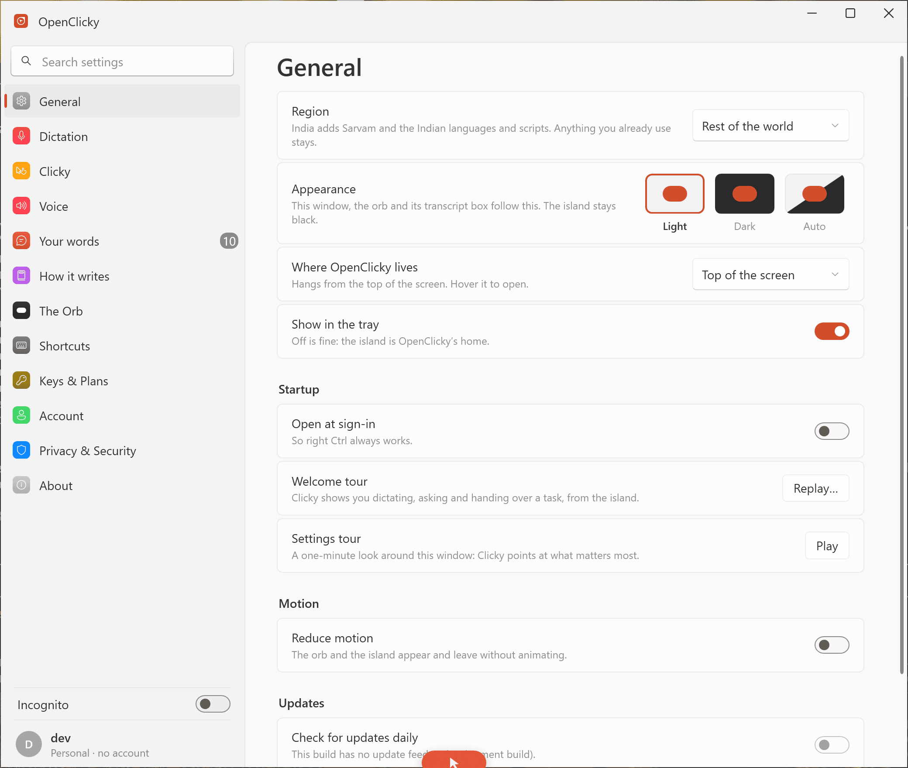
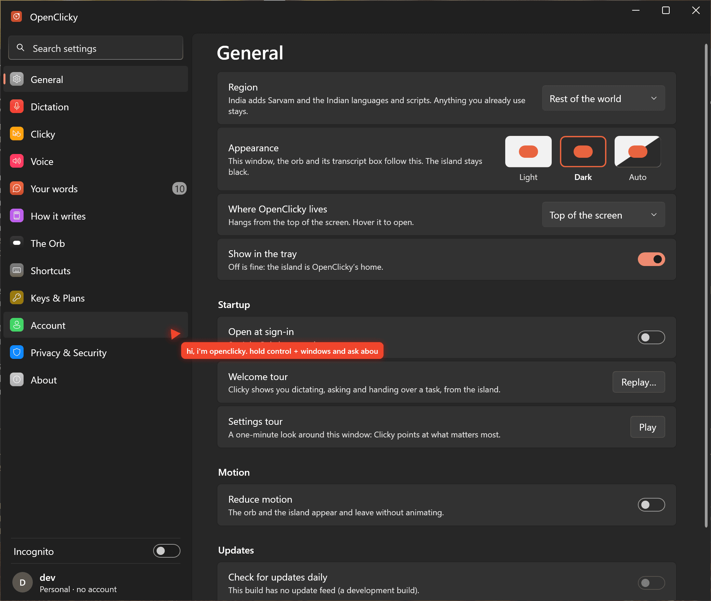

# Clicky Bro

### Your desktop, explained. Your words, written. Your work, moving.

**A native, local-first AI companion for macOS and Windows.** Ask about a window you choose, dictate with on-device speech recognition, and delegate bounded tasks to persistent helpers.

  
  
  
  
  

[Get started](#get-started) · [Capabilities](#capabilities) · [Offline dictation](#offline-dictation) · [Security](#privacy-security-and-authority) · [Development](#development-and-verification) · [Roadmap](docs/PRODUCT_ROADMAP.md)

---

> [!IMPORTANT]
> **Development alpha, not an approved general release.** Clicky Bro builds on an existing native application and has source for many features, but the **current development bundle has not passed full Screen Recording, microphone, focus/insertion or physical Windows acceptance**. Historical tests do not prove the current commit works on real hardware. There are no signed/notarised public installers yet. See [build status](docs/BUILD_STATUS.md).

## The idea

Most desktop assistants specialise in speech-to-text, visual question answering or AI task execution. Clicky Bro brings these together without obscuring **what is shared, what runs locally and which actions require approval**.

| **Ask & learn** | **Dictate & write** | **Work with helpers** |
| :--- | :--- | :--- |
| Select **one window** for contextual answers and pointer-based guidance. Observation is not permission to click. | Use native Apple Speech or a downloadable Parakeet model for local transcription. Cloud providers remain optional. | Create bounded helpers with explicit workspace write permission, opt-in memory, local interval routines and saved artifacts. |
| Capture fails closed when the selected target disappears; no automatic full-desktop fallback is intended. | Formatting, keyboard shortcuts, history and insertion are present in the native foundation. | Direct Gemini supports scoped workspace file tools; general account integrations are **not** assumed to work. |
| **Needs current-bundle permission and teaching acceptance.** | **Needs real audio and focus acceptance.** | **A historical text helper/restart-persistence slice passed.** |

### Existing native interface

  
  

Historical Windows captures from the adopted foundation, before the Azure theme changes. These are neither fresh screenshots nor proof of a finished redesign. Fresh device screenshots are a release gate.

**Approved visual direction:** Preserve the current native settings layout and calm light/dark styling. Classic Coral is the default; Azure Blue, additional colour presets and separate cursor colours are planned as optional personalisation. The logo above is a new repository-owned SVG; the existing native app icons remain separate and should not be represented as updated until their platform builds are verified. The [Azure token catalogue](design/tokens.json) synchronises semantic palettes across SwiftUI and WPF; [design specification](docs/DESIGN_SYSTEM.md). A completely new Home/conversation/workspace layout is still planned, not claimed as delivered.

## Capabilities

| Capability | Current source | Acceptance status |
| --- | --- | --- |
| Native macOS app and menu-bar companion | Implemented foundation | Signed/current-bundle capture and full interaction testing open |
| Windows WPF companion | Implemented foundation | Historical portable core tests and cross-build; physical Windows acceptance open |
| Chosen-window capture and guidance | Implemented foundation | Permission denial, moving windows and multi-display testing open |
| On-device Apple Speech | Implemented foundation | Real dictation/insertion acceptance open |
| NVIDIA Parakeet V3 (~465 MB model archive) | Implemented macOS and Windows | Real-model quality and installation benchmarking open |
| Cloud transcription and model polishing | In adopted code | Provider/account-specific tests required |
| Helpers, opt-in memory, routines and text artifacts | Implemented macOS foundation | Historical helper/restart evidence; broader lifecycle and Windows parity open |
| Gemini BYOK and bounded workspace tools | Implemented | Native action approvals and cancellation need acceptance |
| Offline test runner | Merged to main | Missing prerequisites count as incomplete, not success |
| Whisper, complete offline-only privacy mode, full-document retrieval | **Planned** | Not integrated or released |

[Competitor feature crosswalk](docs/FULL_SPEC_CROSSWALK.md) and [roadmap](docs/PRODUCT_ROADMAP.md) track more granular states. Source presence is not an end-to-end pass.

## Get started

These instructions start the **development build from source**, not a consumer installer. Use disposable files when testing automation. Do not commit API keys.

### macOS

Requires Xcode, Node.js 24 and Python 3.9+:

~~~bash
git clone https://github.com/Itskorrah/clicky-bro.git
cd clicky-bro
npm ci --prefix app --ignore-scripts
npm run build --prefix app --workspace agent
python3 scripts/gemini.py configure
python3 scripts/dev.py build
python3 scripts/dev.py launch
~~~

The Gemini key prompt hides input. The launcher stages development products under the clicky-bro user cache and preserves the isolated runtime under Application Support. Prior ignored local runtime files are migrated conservatively; originals are preserved.

**Mac permissions are tied to the exact running build.** Follow [macOS troubleshooting](docs/TESTING_MACOS.md) to configure Screen Recording, microphone, speech and Accessibility. An old OpenClicky entry does not prove the current build can capture a frame. See [Gemini setup](docs/GEMINI_SETUP.md) for tests that may consume quota.

### Windows

The native client uses WPF/C# with the shared TypeScript agent. On Windows 11 x64 install Node.js 24 and the .NET 8 SDK; use [Windows testing instructions](docs/TESTING_WINDOWS.md). Minimal developer build:

~~~powershell
npm ci --prefix app --ignore-scripts
npm run build --prefix app --workspace agent
dotnet build app/windows/OpenClicky.Windows.sln -c Debug
dotnet run --project app/windows/src/OpenClicky.Windows -c Debug
~~~

A macOS cross-build does not prove native Windows capture, focus, microphone, hotkey or input behaviour.

## Offline dictation

There are currently two local speech routes on the Mac:

- **Apple Speech:** no extra model download; on-device operation depends on the supported OS/language.
- **Parakeet V3 through sherpa-onnx:** approximately 465 MB downloaded archive, SHA-256 integrity checking, progress, cancellation, removal and memory-pressure/idle unload. It supports 25 primarily European languages, **not Arabic**.

The Windows foundation also implements Parakeet. Local transcription has **no per-minute cloud API quota**, but uses CPU, memory and disk. Optional transcript polishing can independently use a cloud model, so a local recogniser does **not** necessarily make the final writing process offline.

Downloadable multilingual Whisper models, long-form VAD and a guaranteed offline-only mode are prioritised in the [speech roadmap](docs/PRODUCT_ROADMAP.md). None is currently marketed as completed.

## Privacy, security and authority

**A local-first design, not a claim of formal security certification.**

- **Deliberate visual sharing.** A person chooses a window; the capture code rejects stale/missing targets rather than expanding to the whole screen.
- **Separate transcription and polishing.** Local speech, cloud transcription and model-based text clean-up have different data destinations.
- **Observation is not action.** Ask/Teach must not silently authorize computer control.
- **Scoped workspace permissions.** File writes require the helper's separate opt-in. **This opt-in currently grants broad writes within the workspace; it is not per-file native confirmation.** Use a disposable workspace.
- **Effective cancellation matters.** Native Stop, pending approvals and selected-window diagnostics are in [PR #1](https://github.com/Itskorrah/clicky-bro/pull/1), pending full fresh device verification.
- **Licences stay attached.** The adopted core is MIT; third-party runtime/model licences and redistribution must be reviewed before distribution.

See [source provenance](docs/PROVENANCE.md) and [build evidence](docs/BUILD_STATUS.md).

## Development and verification

The app retains native SwiftUI/AppKit and WPF clients, rather than running as a browser wrapper.

~~~text
app/macos/OpenClicky/       SwiftUI + AppKit, window capture and voice
app/windows/                Windows WPF client and .NET core
app/agent/                  TypeScript Gemini/Codex agent and workspace tools
app/backend/                Optional provider backend
design/tokens.json          Cross-platform Azure colour contract
scripts/dev.py              Native macOS development launcher
scripts/check_local.py      CI-free local verification
tests/                      Python, integration and token-parity tests
docs/                       Setup, security, roadmap and evidence
.agents/skills/evolve/      Audit → implement → verify → deliver workflow
~~~

### Run local tests without GitHub Actions

GitHub Actions allocation can be exhausted. Run tests on a suitable local machine:

~~~bash
npm ci --prefix app --ignore-scripts
python3 scripts/check_local.py --list
python3 scripts/check_local.py --report .local/evidence/checks.json

# On a Mac with Xcode:
python3 scripts/check_local.py --native

# With .NET SDK for portable Windows core tests:
python3 scripts/check_local.py --windows
~~~

Exit code **0** means all selected checks passed; **1** means a test failed; **2** means at least one was skipped. The optional report never writes captured command output or provider secrets, and existing reports are not overwritten. No source-only test can substitute for real OS permission/audio/GUI acceptance.

The [dated development status](docs/BUILD_STATUS.md) reports historical 18 October results: 705 macOS unit tests, 119 TypeScript tests and 15 offline Python tests passed; Windows portable core reported 1,066/1,071, including five upstream-matching failures. **These numbers are historical and predate the current design work and native PR.** Do not use them as release certification.

## Roadmap and production gates

| Milestone | Acceptance target |
| --- | --- |
| **Native baseline** | Current-bundle selected-window, microphone, focus-safe insertion and Stop proven on a real Mac |
| **Visual design** | Azure across Home, companion, dictation, workspace and settings; contrast/keyboard/dark-mode screenshots |
| **Local voice** | User-consented Whisper models benchmarked against Parakeet, with local-only audio and optional local text clean-up |
| **Useful intelligence** | Document context and grounded teaching, safe file approvals, durable tasks and search |
| **Distribution** | Physical Windows parity, stable macOS identity, signed installers and tested updates |

See the detailed [product roadmap](docs/PRODUCT_ROADMAP.md), [feature audit](docs/FEATURE_AUDIT.md) and [competitive crosswalk](docs/FULL_SPEC_CROSSWALK.md).

## Contributors, licensing and acknowledgements

Read [AGENTS.md](AGENTS.md), [foundation decision](docs/FOUNDATION_DECISION.md) and [Evolve engineering skill](.agents/skills/evolve/SKILL.md) before changing native input, permissions or agent authority. Preserve user state, use benign fixture data, and report real platform/commit identifiers with verification.

The native foundation is based on the pinned [Prasanth OpenClicky](https://github.com/prasanthsasikumar/openclicky) MIT source; original credits and licences are preserved under app/. See [PROVENANCE.md](docs/PROVENANCE.md). HeyClicky and Superwhisper are independent competitive references, not affiliated projects. No proprietary competitor artwork is used in the new design direction.

  Built for a desktop assistant that is pleasant to use, clear about its permissions, and honest about what works.

