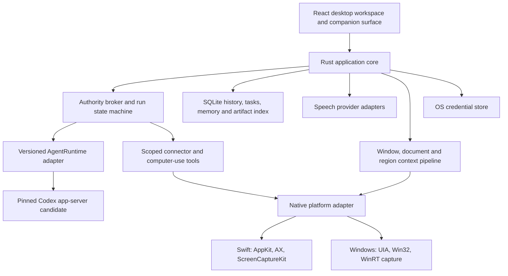

# clicky-bro: product and engineering plan

Prepared 17 October 2026; reconciled with implementation on 18 October 2026.
**clicky-bro is the user-selected project name.** The research and proposed
milestones below describe the full product ambition. Current implementation and
verification are tracked in [BUILD_STATUS.md](BUILD_STATUS.md), with the next
acceptance work in [NEXT_STEPS.md](NEXT_STEPS.md).

## Decision

Build an original desktop assistant for teaching, dictation and delegated work,
with macOS and Windows as explicit platform implementations. Adopt the pinned
MIT Prasanth OpenClicky native Swift/C#/TypeScript foundation under `app/`,
preserving attribution. The comparison rejected ClickyX for this phase; see
[FOUNDATION_DECISION.md](FOUNDATION_DECISION.md). The earlier Tauri/React/Rust
proposal below is historical design exploration and is superseded by this native
foundation decision. Do not start a second application framework from that diagram.

The commercial reference includes more than its original public prototype:
persistent helpers, agent execution, integrations, files, routines and suggestions.
Adopting source alone does not establish parity. Track each capability through
actual acceptance, including failure, stop/recovery and physical Windows testing.

## Read these deliverables together

| Document | Purpose |
| --- | --- |
| [FEATURE_AUDIT.md](FEATURE_AUDIT.md) | All seven public sitemap routes, complete published changelog, 27 feature areas, source anchors, current/paused/removed distinctions and 20 acceptance scenarios. |
| [INSTALLED_APP_ARCHITECTURE.md](INSTALLED_APP_ARCHITECTURE.md) | Installed 1.0.53(64), native runtime/helper findings, four successful targeted decompilations, evidence ledger and unresolved runtime questions. |
| [DEVELOPMENT_PROTOCOL.md](DEVELOPMENT_PROTOCOL.md) | Evaluated tools/skills, pinned source revisions, existing laptop constraints, agent roles, model choices and verification rules. |
| [REA_SETUP.md](REA_SETUP.md) | Existing local REA/Ghidra integration and initial whole-image analysis limitations. |

Research snapshots and native evidence stay in ignored `.local/`. Documents record interpretations and primary references. Original application bytes were not changed or executed.

## Product promise and original identity

One companion should help in three clear modes:

1. **Explain:** understand a deliberately shared screen/window/document, speak or write an answer, and guide the user visually. Observing or pointing does not authorize clicking.
2. **Write:** turn speech into accurate text in the intended field, with visible recovery if insertion fails.
3. **Work:** run a scoped task in a persistent helper, with progress, explicit authority, useful outputs and dependable stop/resume behavior.

These modes can share conversation context while keeping their authority distinct. An ambiguous “yes” must not authorize a different pending action. Make the mode, shared context and current work understandable in the interface.

Use original typography, colors, animation, character assets and interaction design. The companion can be a small edge/dock surface on either platform, opening a proper task/chat workspace. A macOS notch treatment is optional; Windows should get a coherent edge/tray design. Do not force a fake notch or transplant every marketing animation.

The project name is **clicky-bro**, selected by the user. Use this name in project-owned documentation and future product surfaces. The existing checkout path is `/Users/korrah/Documents/ChatGPT/clicky-pal`; renaming the checkout is separate from changing the product name.

## Parity means a tracked contract

The baseline is the published current feature set through HeyClicky 1.0.53, corroborated where possible by the installed artifact. First-party claims, code present, runtime verified and our own proposals remain separate columns. Full private feature completeness cannot be certified from a website and static binary alone.

Implement the valuable current behavior and assess useful historical capabilities deliberately. Community Skills, Notes, activity-tracking suggestions and the removed agent cursor layer are not automatically current requirements. Teaching overlays remain in scope. Paused integrations do not count as working integrations. Experimental always-on voice needs its own user-visible label and acceptance gate.

Each backlog item will have `feature_id`, reference version/source, user trigger, expected result, edge cases, authority, implementation state, macOS evidence, Windows evidence, live-provider evidence and unresolved questions. Feature parity is achieved only when the required scenarios pass on the claimed platform. A mocked event stream is useful transport evidence, not a real agent task.

### Coverage and delivery order

| Feature IDs from audit | Intended delivery | Notes |
| --- | --- | --- |
| F01–F08 voice, text, screen/document context, teaching, drawing and dictation | M1–M2, refine at M5 | Keep teaching separate from automation; actual insertion/audio tested natively. |
| F09–F12 named helpers, conversations, memory and lifecycle | M3 | Durable sessions, scope, follow-ups, cancellation and recovery. |
| F13–F15 computer use, browsing, integrations/custom MCP | M4 | Consent enforced outside prompts; start with a small fully tested connector set, grow the catalog. |
| F16 files and previews | M3–M4 | Provenance, safe rendering and the formats users actually need. |
| F17 routines; F18 suggestions | M5 | Local sleep/offline semantics first; optional remote execution is a separate hosted feature. |
| F19–F22 home, personalization, onboarding and quiet behavior | M1 shell, M6 polish | Original design; accessible/reduced-motion UI; no claim of pixel parity. |
| F23 accounts; F24 plans/quotas/teams; F27 referrals | M7 | App accounts differ from provider/connector authentication. Commercial functions have a delivery path but do not block a useful local prototype. |
| F25 distribution and updates; F26 platforms | M0 feasibility, M6 release | Real installation, upgrade and desktop acceptance on each claimed OS. |

## Earlier proposed architecture (superseded)

This is our design, not a recovered diagram of HeyClicky's private code.

Tauri uses OS WebViews, which gives us a shared interface but still exposes platform rendering differences. Its Rust core can manage windows/state/IPC. Neither Tauri capabilities nor a native helper automatically sandbox an arbitrary agent shell. [Tauri process model](https://v2.tauri.app/concept/process-model/), [capabilities](https://v2.tauri.app/security/capabilities/).

### Module and data boundaries

| Boundary | Proposed contract |
| --- | --- |
| `AgentRuntime` | Versioned start/resume/steer/cancel, ordered events, approval requests, usage and terminal results. Capability negotiation; incompatible versions fail explicitly. |
| `RunController` | Owns task identity, generation IDs, deadlines, grants and artifact receipts. States include queued, observing, waiting for approval, running, cancelling, completed, failed and interrupted. |
| `NativeDesktop` | Window/display IDs, snapshot dimensions/scales, accessibility queries, scoped actions, text insertion, hotkeys and permission state. Typed unsupported/denied/stale outcomes. |
| `ContextPipeline` | Selected source, timestamp, content digest, coordinate transform, exclusions and redaction. Revalidate stale observations before action. Support files/documents separately from screenshots. |
| `SpeechInput` / `SpeechOutput` | Streaming events, language/device, interruption, partial/final transcript, reconnection and cancel. Preserve raw transcript when optional cleanup fails. |
| `ConnectorRegistry` | Provider/account identities, scopes, connect/revoke/refresh, tool schema and structured errors. Never silently switch the account for a write. |
| `MemoryStore` | Agent/user/task scope, source, date, confidence and expiry; inspect/edit/delete/export. Retrieved context has size limits and cannot grant authority. |
| `ArtifactStore` | Per-run files, MIME/type, provenance and safe preview. Isolate active HTML/remote content from privileged app IPC. |
| `Scheduler` | Timezone-aware schedule, durable due state, one bounded catch-up, run lease and outcome; distinguish local and hosted execution. |
| `CredentialStore` | macOS Keychain and a Windows OS-backed store; secrets stay out of the renderer, prompts, ordinary logs and exported diagnostics. |

Use one local SQLite database with explicit migrations and synthetic migration fixtures. File artifacts live in per-helper/run directories indexed by the database. Read the agent runtime's data through supported protocol APIs; do not make the product depend on undocumented internal Codex SQLite tables. Maintain our run/artifact/permission state separately from the backend's conversation representation.

Proposed repository layout after build approval: `apps/desktop`, `crates/core`, `crates/runtime-codex`, `crates/policy`, `crates/storage`, `native/macos`, `native/windows`, `tests/fixtures`, `tests/desktop`, `docs/decisions`. Start with a few real boundaries; split crates only where ownership/build needs justify them. This layout is a plan, not existing files.

### Agent runtime and service choices

Start by testing the official Codex app-server interface behind `AgentRuntime`, because the shipped-app evidence and official integration surface fit persistent threads, streaming work, tools and approvals. Use the upstream distribution and its actual license/NOTICE obligations; do not copy HeyClicky's bundled executable, helper, prompt library or private proxy configuration. Generate/validate types from the selected pinned runtime protocol. [Official app-server docs](https://learn.chatgpt.com/docs/app-server), [upstream source](https://github.com/openai/codex/tree/main/codex-rs/app-server), [upstream license](https://github.com/openai/codex/blob/main/LICENSE).

Product authentication/inference is a separate decision from using Codex to develop the code. First prove transport and lifecycle with controlled local child-process fixtures and recorded events. Then choose supported, user-authorized provider authentication for live tests. Never borrow the developer's Codex tokens or configure inference spending as an incidental test. BYOK is a useful initial option to evaluate; supported customer sign-in may be another. Service terms, entitlements and billing must be verified at that decision, not inferred from an open-source license.

Avoid a production backend initially unless a validated workflow needs one. A sellable managed offering later needs authenticated inference/connector access, per-user quotas, rate limits, idempotency, deletion and operational cost controls. Local-first storage and local development do not imply offline model processing. A remote routine service would need its own credentials, execution isolation, billing and availability contract.

### Authority and recovery are product features

Model output, skill text and retrieved web/document content cannot grant permissions. The host broker authorizes tool invocation with an expiring grant bound to user request, run, target application/account/path, action class and descendants. Observation, file writes, shell execution, network access and GUI input need their own treatment. Cancelling a run revokes its grants and rejects late events.

The backend must run with enforceable restrictions appropriate to the approved scope; intercepting only the GUI MCP endpoint does not stop a full-access shell from bypassing it. Prove backend approval/sandbox behavior and close alternate execution routes before exposing real computer control. Prefer supported runtime restrictions and narrow host-owned tools; if an operation cannot be constrained reliably, keep it behind explicit elevated authority and state the limitation.

For external writes, store intent and request identity before execution. Use connector idempotency when supported; otherwise reconcile the outcome after disconnect rather than retry blindly. “Exactly once” is not a universal guarantee. Stop should halt new tools immediately, interrupt the active runtime/helper where supported, and display uncertain outcomes for already-issued irreversible actions. File undo or compensating actions are offered only where the particular operation supports them.

## macOS and Windows implementation split

| Capability | macOS candidate | Windows candidate / key test |
| --- | --- | --- |
| Companion/tray/overlay | AppKit panel/window integration behind Tauri | Tray + non-disruptive Win32 overlay; focus/virtual desktop/multi-monitor checks. |
| Screen/window context | ScreenCaptureKit and AX metadata | Windows.Graphics.Capture and UIA; system capture UX and denied/protected surfaces. |
| Teaching/drawing | Click-through per-display overlay, point↔pixel transforms | Per-monitor DPI-aware overlay, negative origins and rearrangement. |
| Audio | AVFoundation/CoreAudio bridge | WASAPI/WinRT bridge; device switch and exclusive-device failure. |
| Hotkeys | Global shortcut/event handling with required consent | RegisterHotKey or narrowly scoped hooks where necessary; IME/layout/conflict checks. |
| Text insertion | AX-first, selected fallback with clipboard restoration | UIA ValuePattern.SetValue where supported; TextPattern for reading/selection, not insertion; explicit foreground input fallback and target revalidation. |
| Computer use | AX app/window actions first | UIA patterns first; app-specific coverage and integrity-level limits. |
| Startup, secrets, updates | User-chosen login item, Keychain, signed/notarized app | User-chosen autostart, OS credential store, signed installer/update. |

Windows is feasible, but macOS native code cannot simply run there. Microsoft documents capture selection and device support; `SendInput` has integrity-level limits and is not a universal background-control API. UIA TextPattern provides read/selection access rather than text mutation. Do not promise control of UAC/secure desktop or arbitrary elevated apps. [Windows capture](https://learn.microsoft.com/en-us/windows/apps/develop/media-authoring-processing/screen-capture), [SendInput](https://learn.microsoft.com/en-us/windows/win32/api/winuser/nf-winuser-sendinput), [UIA TextPattern](https://learn.microsoft.com/en-us/windows/win32/winauto/uiauto-about-text-and-textrange-patterns).

Initially propose macOS Apple Silicon and Windows 11 x64; Intel Mac and Windows ARM64 are additional declared targets after runtime/helper availability and native testing. Record minimum OS versions from our implementation dependencies, not by inheriting HeyClicky's minimum blindly. A Windows ARM VM on an 8 GiB Mac can assist with some checks but does not replace Windows x64/hardware, audio and focus acceptance. No Windows host or VM was provisioned or tested in this phase.

## Milestones and exit gates

No fixed calendar estimate is justified yet. M0 will measure integration effort; subsequent estimates should use completed slices and a risk register.

| Milestone | Deliverable | Exit gate / acceptance evidence | Suggested Codex model |
| --- | --- | --- | --- |
| **M0 — feasibility and environment** | Pinned project toolchain, concise AGENTS instructions, native bridge contract, minimal companion on both platforms and fake runtime transport | Hotkey→overlay; selected-window capture; mixed-DPI coordinate probe; synthetic text insertion in a disposable app; deny/stop; restart state; clean child-process exit. Real OS evidence, no inference required. Compare Tauri/Electron only if a specific blocker appears. | GPT-6.1 Sol **High** for platform/architecture; Medium for mechanical setup. |
| **M1 — useful vertical slice** | Original desktop workspace, text chat, explicit screen/window sharing and one teaching flow | A01–A04, A19; observed context matches shared source; no accidental action authority; provider-fixture vs live evidence separate. | Sol **Medium**, High for concurrency/permissions. |
| **M2 — voice and dictation** | Push-to-talk, streaming/cancel, TTS/interruption, selected voices/languages, dictionary corrections, language defaults, field-aware cleanup, dictation/insertion and drawing input | A05–A08 on both OSes; focus changes cannot redirect transcript; quiet/error/reconnect states; compare latency and fidelity using the same fixtures, including cleanup fidelity and dictionary behavior. Always-on remains optional until separately accepted. | Sol **High** for native audio/state; Medium for UI. |
| **M3 — durable helpers and artifacts** | Named scoped workers, search/archive/pins, steer/retry, memory editor, attachments/output previews | A09–A10, A16–A17; restart/corruption/migration tests; cancel revokes authority; artifact attached to correct run; no cross-helper memory leakage. | Sol **Medium**, High for persistence/lifecycle review. |
| **M4 — real delegated action** | Tested connector paths, custom MCP stdio/HTTP+OAuth, multi-account selection, background browser/native actions | A11–A13; one denied and one allowed task; revoke during pending tool; no unapproved external action or focus theft; unreliable pixel routes shown as explicit fallback. | Sol **High** for runtime, policy and OAuth. |
| **M5 — routines and suggestions** | Local schedules, sleep/network recovery, scoped opt-in suggestion researcher, completion notifications | A14–A15; clock/DST/restart tests; bounded catch-up; researcher read-only; approval tied to suggestion; clear local/remote availability. | Sol **High** for scheduler/authority; Medium for UI. |
| **M6 — release quality** | Onboarding/personality, quiet modes, accessibility, diagnostics/export, signed installers and updates | A02/A18–A20 plus platform matrix; fresh install/upgrade/uninstall; release build contains no test driver or secrets; measured memory/CPU/battery and inference cost. | Sol **Medium**, High independent review. |
| **M7 — commercial offering** | Product accounts, managed inference/connector auth where chosen, plans/quotas, team policy and later referrals | Billing/quota/auth/revoke/delete acceptance, abuse/cost controls, dependency notices and support process; no launch until product claims match tested behavior. | Sol **High** for service/billing boundaries; Medium for ordinary screens. |

The 20 acceptance scenarios are expanded in FEATURE_AUDIT.md. Maintain individual feature states rather than marking a whole milestone done because its interface renders. A Windows build is build evidence; passing a UI test through a mocked bridge is UI evidence; neither is native Windows acceptance.

## How we make it better

Prioritize improvements that can be demonstrated:

- **Control what is shared:** a visible window/region/document source, exclusions and preview/redaction, with persistent indicators and a text-only route.
- **Understand what happened:** per-run tool/action receipts and source-linked artifacts; explain denial, unsupported behavior and uncertain outcomes accurately.
- **Trust memory:** show what is remembered, where it came from, its scope and age; edit, forget and export it without digging through hidden files.
- **Recover work:** dependable stop/restart, resumable tasks, deduplicated routines and connector reconciliation; no false “done” message on a failed tool.
- **Protect attention:** teach/control modes visibly distinct, no surprise focus changes, keyboard access and reduced motion, quiet completion handling.
- **Manage cost:** task budgets, usage visibility, bounded tool loops and optional local transcription only after measuring quality/resources on this laptop.
- **Support Windows well:** a platform-native companion surface and tested automation behavior, rather than a nominal cross-platform build.

These are proposed advantages, not benchmarks already won against HeyClicky. Measure equivalent scenarios, including failures, before advertising “faster”, “more private” or “more reliable”. Do not add a hundred connectors at the expense of getting the first few right.

## Development environment and agent protocol

Use the existing local Codex/REA/Context Mode setup. For the next build phase, pin Node/package manager, Rust toolchain and lockfiles; install only missing prerequisites. Rust/Cargo were not found on the current shell PATH. Evolve requires Python 3.10+; the shell's Python 3.9 is insufficient, although its 60 tests passed here through Context Mode's Python 3.12. Preserve all existing user settings and work.

Use one coordinator, one implementer per owned boundary and an independent reviewer for substantial milestones. Parallelize independent research and disjoint modules after contracts are settled. Agents do not share ownership of the same files or run competing installers/analysis jobs. On this **8 GiB** laptop, serialize expensive Rust builds, Ghidra analysis and local-model/VM experiments. Development delegation uses Codex's existing agents; no extra swarm framework is justified yet.

Evolve is the preferred planning/build/verification discipline. Context Mode is useful for output processing but its connected tools do not prove hooks fired; verify lifecycle support separately if we depend on it. REA stays a targeted research tool. Replica supplies useful comparison templates but its original recon rules and web-hosting defaults do not fit this authorized source/binary investigation. See DEVELOPMENT_PROTOCOL.md for pinned revisions, licenses and limitations.

For UI tests investigate current WebdriverIO/Tauri embedded-driver support on both desktop platforms; keep test-only plugins out of release builds. Use renderer tests for interface states and native harnesses for capture/permissions/focus/audio. [Current Tauri WebDriver guide](https://v2.tauri.app/develop/tests/webdriver/).

Model defaults: **GPT-6.1 Sol Medium** for routine implementation; **High** for architecture, native behavior, security and substantial review. Use Luna for tightly bounded extraction only if explicitly selected and supported; escalate difficult unresolved questions to Astra only with a focused evidence package. Higher reasoning is not a substitute for actual runtime/OS tests, and every routine edit does not need Max/Ultra. Explain model/effort at each milestone; this plan does not change current model settings. [Official model guidance](https://learn.chatgpt.com/docs/models).

## Open decisions and next concrete work

The plan recommends defaults so routine choices do not stall development:

1. Use clicky-bro as the project name.
2. Compare the pinned Prasanth OpenClicky and ClickyX foundations using builds, existing tests and the same native probes. Choose the foundation and record reuse/provenance before scaffolding. See RESEARCH_UPDATE.md and NEXT_STEPS.md.
3. Use a local Windows 11 x64 test machine when available. If only an ARM VM is available, label its narrower evidence; do not claim x64 acceptance.
4. Use the verified Gemini development connection for bounded live checks. Validate its integration with the selected runtime; the Python connection probe is not itself the product agent runtime. Keep customer authentication and commercial inference as later decisions.
5. Begin with one excellent teaching/dictation/delegation workflow, then close the parity matrix by milestone. Commercial features remain explicit later work.

The highest remaining uncertainties are real native focus/capture behavior, provider and connector authentication, safe arbitrary tool execution, and the installed product's unobserved runtime details. The next useful work is the native acceptance and remaining feature work in NEXT_STEPS.md, with concrete screenshots, traces and pass/fail results. More broad decompilation or adding more agent tools is unlikely to resolve those risks as effectively.
